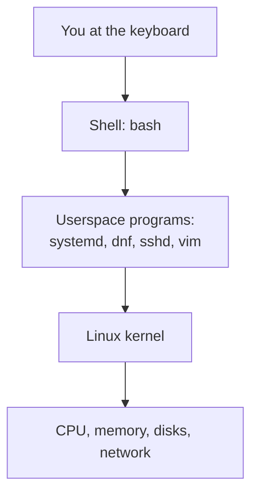
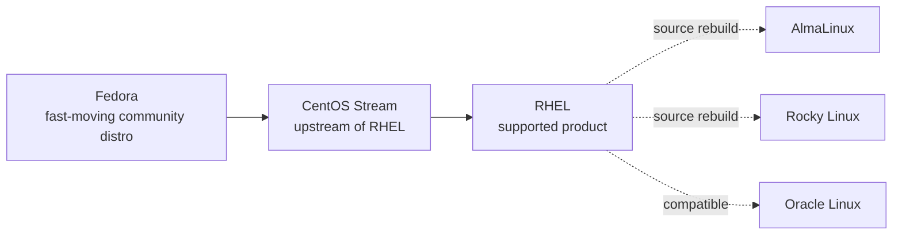

# F1 — Linux, open source, and the RHEL family

<div class="module-meta" markdown>

| | |
|---|---|
| **Time** | 45–60 minutes |
| **Prerequisites** | None. The commands are RHEL-family commands; run them in the lab. |
| **Lab** | A short command walkthrough on the lab `server` |
| **Self-check** | At the end of the page |

</div>

You can pass some RHCSA tasks by memorizing commands. You cannot troubleshoot them without a mental model of what is running underneath.

This module builds that model: what the kernel does, what userspace does, why distributions exist, where Red Hat Enterprise Linux sits in the family, and why the course uses AlmaLinux in the lab while targeting RHEL 10 for the exam.

## The shape of a Linux system

A Linux system is layered. Each layer has a job, and each layer depends on the one below it.



The shell is itself a userspace program. So is `systemd`, the service manager that becomes the first process at boot.

### The kernel

The **kernel** is the core program that talks directly to hardware. It is loaded by the bootloader, stays in memory, and runs with privileges that ordinary programs do not have.

Its responsibilities include:

- scheduling processes on the CPU,
- allocating memory,
- reading and writing disks through filesystems,
- sending and receiving network packets,
- enforcing permissions and security policy,
- providing device drivers.

Userspace programs do not touch hardware directly. They ask the kernel through **system calls**: `open()`, `read()`, `write()`, `fork()`, `execve()`, and so on. The shell command `ls` eventually becomes a series of system calls that open a directory, read its entries, and write text to your terminal.

You can see the running kernel version with:

```bash
uname -r
```

A RHEL 10-family system reports a kernel whose release tag contains `el10`, for example:

```text { .no-copy }
6.12.0-211.74.1.el10_2.x86_64
```

The exact version, and the `el10_2` minor suffix, change with updates. The important part is that the kernel is separate from the rest of the system and can be updated independently.

### Userspace

**Userspace** is everything outside the kernel: the shell, the package manager, the SSH server, the web server, the libraries, and the tools you type at the prompt.

Two userspace programs matter immediately:

| Program | Job |
|---|---|
| `systemd` | Becomes PID 1 at boot and starts or supervises the rest of the system |
| `bash` | Reads your commands, expands them, and runs programs |

Check PID 1:

```bash
ps -p 1 -o pid=,comm=
```

On every RHEL 10-family system, this prints:

```text { .no-copy }
1 systemd
```

That single line explains a lot of later material. Services are not started by magic scripts in `/etc/init.d`; they are units managed by `systemd`. Targets, timers, mounts, and sockets are all units too.

### The shell

The **shell** is a command interpreter. It is not the kernel. It reads a line, applies quoting and expansion (replacing `$HOME` with its value, `*.txt` with the files it matches), finds the program, asks the kernel to run it, waits for it to finish, and records its exit status.

That division of labor explains several things you will practice in R1:

- `echo '$HOME'` prints the literal text because the shell does not expand variables (named values such as `HOME`) inside single quotes.
- `ls -l /var/log` works because whitespace separates arguments; `ls -l/var/log` does not.
- `command > out.txt 2>&1` redirects streams because the shell sets up file descriptors — the numbered channels (0 for input, 1 for output, 2 for errors) a program reads and writes — before the program starts.
- `echo $?` shows the previous command's exit status because the shell remembers it.

You can confirm which shell you are using:

```bash
echo "$SHELL"
ps -p $$ -o comm=
```

`$$` is the process ID (PID) of the current shell.

## Why distributions exist

The kernel alone is not a usable operating system. You also need an init system, core utilities, a package manager, an installer, default configuration, security policy, and someone to ship updates.

A **distribution** bundles those choices into a coherent product. Different distributions make different choices:

| Family | Package format | Package manager | Examples |
|---|---|---|---|
| Debian | `.deb` | `apt` | Debian, Ubuntu |
| Red Hat | `.rpm` | `dnf` | RHEL, Fedora, AlmaLinux, Rocky Linux |
| SUSE | `.rpm` | `zypper` | SUSE Linux Enterprise, openSUSE |
| Arch | `.pkg.tar.zst` | `pacman` | Arch Linux |

The package format is not the only difference. Distributions also differ in release cadence, default filesystem, security defaults, support lifecycle, and the versions of software they ship. That is why a command can work on Ubuntu and fail on RHEL, or the other way around.

This course stays inside the Red Hat family.

## The RHEL family tree

The names are easy to mix up. The relationships matter more than the labels.



| Name | What it is | Support model | Role in this course |
|---|---|---|---|
| **Fedora** | Fast-moving community distribution sponsored by Red Hat | Short release lifecycle | Not used; many RHEL features appear in Fedora first |
| **CentOS Stream** | Rolling development branch immediately upstream of RHEL | Community | Not used; explains where RHEL changes come from |
| **RHEL** | Red Hat's commercially supported enterprise distribution | Red Hat subscription | **Exam target** |
| **AlmaLinux** | Community rebuild built from RHEL source | Community, free | **Default lab box** |
| **Rocky Linux** | Community rebuild built from RHEL source | Community, free | Alternative lab box |
| **Oracle Linux** | RHEL-compatible distribution with Oracle support | Oracle | Alternative, not used here |

Two distinctions are worth remembering:

- **CentOS Stream is upstream of RHEL.** It is where changes are developed and tested before they land in a RHEL minor release. It is not a RHEL rebuild.
- **AlmaLinux and Rocky Linux are downstream rebuilds.** They take the RHEL source code and build their own distribution from it. They aim to be binary-compatible, but they are separate products with their own names, infrastructure, and support.

That is why the course can use AlmaLinux for practice while still preparing you for a RHEL exam. The administration model is the same: `systemd`, SELinux, firewalld, DNF, NetworkManager, LVM, and the same filesystem layout.

### Major and minor versions

RHEL uses two levels of version number:

- **Major version:** RHEL 10. This is the platform. It has a long lifecycle and defines the major changes.
- **Minor version:** RHEL 10.0, 10.1, 10.2, and so on. These are updates within the major release: fixes, hardware support, and selected features.

The exam says **RHEL 10**, not a specific minor release. Learn the platform, not a point release.

You can see the version of the system you are on:

```bash
cat /etc/os-release
```

On AlmaLinux it looks like this:

```text { .no-copy }
NAME="AlmaLinux"
VERSION="10.x"
ID="almalinux"
ID_LIKE="rhel centos fedora"
VERSION_ID="10.x"
PRETTY_NAME="AlmaLinux 10.x"
```

The `ID_LIKE` line is the useful one: it tells you the distribution follows RHEL conventions. On a real RHEL system, `NAME` is `Red Hat Enterprise Linux` and `ID` is `rhel`.

### Repositories

RHEL-family systems install software from **repositories**, not from random downloads. RHEL 10 splits its content into two main repositories:

| Repository | Contents |
|---|---|
| **BaseOS** | Core operating-system packages: kernel, systemd, core libraries, base utilities |
| **AppStream** | Applications, runtimes, databases, and other content that can have multiple versions |

AlmaLinux uses the same split. You will configure and use repositories in R3. For now, remember that `dnf` is the package manager and that packages come from configured repositories.

Your lab installs its packages from AlmaLinux's repositories over the internet. The exam machine uses Red Hat's repositories, but the workflow you learn — `dnf repolist`, `dnf install`, `dnf remove` — is the same. See [Lab setup](../../start-here/lab-setup.md).

## Open source, support, and the exam

Linux is **open source**: its source code is available under licenses that grant permission to run, study, modify, and redistribute it. Common licenses include:

- **GPL** — if you distribute a modified version, you must make the source available under the same terms.
- **MIT / BSD** — permissive; you can reuse the code with few conditions.
- **Apache 2.0** — permissive, with an explicit patent grant.

Open source does not mean "no one makes money" or "no support." Red Hat's business model is a **subscription**: customers pay for support, certified hardware and software, security updates, and access to Red Hat's knowledge base and tooling. The code remains open.

This is also why RHEL-compatible rebuilds exist. The code can be rebuilt and redistributed, but the trademarks cannot. AlmaLinux and Rocky Linux can be RHEL-compatible without calling themselves RHEL.

For the exam, the practical consequence is simple: **learn the RHEL way of administering the system**. The branding may differ in the lab, but the commands, configuration files, and service model are the same.

## What the exam expects you to know about the platform

EX200 v10 runs on RHEL 10. You do not need to know every component before you start, but you should recognize the major pieces and what they do.

| Component | Job | Where it appears |
|---|---|---|
| `systemd` | PID 1, service and unit management | F7, R5, R11 |
| SELinux | Mandatory access control | F8, R10 |
| firewalld | Dynamic firewall management | F8, R9, R10 |
| DNF | Package installation and repository management | R3 |
| NetworkManager | Network configuration, including `nmcli` | F8, R9 |
| LVM | Flexible disk storage | R6, R7 |
| GRUB 2 | Bootloader | R11 |
| `journald` | System and service logs | F7, R5 |

The exam is performance-based. You will be given tasks on a live system and judged on the end state, not on the commands you typed. The platform knowledge in this module is the map; the later modules are the practice.

## Lab: identify the system

Run these commands on the lab `server` (or any RHEL-family system you have). If the lab is not running yet, you can read the output first and run them after F2.

```bash
cat /etc/os-release
uname -r
uname -m
ps -p 1 -o pid=,comm=
rpm -q kernel
getenforce
systemctl is-active firewalld
```

On the default AlmaLinux 10 lab, the output resembles:

```text { .no-copy }
$ cat /etc/os-release
NAME="AlmaLinux"
VERSION="10.x"
ID="almalinux"
ID_LIKE="rhel centos fedora"
...
$ uname -r
6.12.0-211.74.1.el10_2.x86_64
$ uname -m
x86_64
$ ps -p 1 -o pid=,comm=
1 systemd
$ rpm -q kernel
kernel-6.12.0-211.74.1.el10_2.x86_64
$ getenforce
Enforcing
$ systemctl is-active firewalld
active
```

Read the evidence:

| Command | What it tells you |
|---|---|
| `cat /etc/os-release` | Which distribution and version you are running |
| `uname -r` | The running kernel version; `el10_2` places it in the RHEL 10 family, minor stream 2 |
| `uname -m` | The CPU architecture; `x86_64` is the exam architecture |
| `ps -p 1` | The init system; `systemd` means units and `systemctl` |
| `rpm -q kernel` | The installed kernel package, managed by RPM/DNF |
| `getenforce` | Whether SELinux is enforcing, permissive, or disabled |
| `systemctl is-active firewalld` | Whether the firewall service is running |

On a real RHEL 10 system, the distribution fields change but everything else looks the same. That is the point of the lab.

!!! note "SELinux and firewalld stay on"
    The lab runs with SELinux enforcing and firewalld active, like the exam. Do not disable either one to make an exercise "work." The later modules teach you how to configure them correctly.

## The RHEL family in one sentence

**RHEL is the supported product; Fedora and CentOS Stream feed it; AlmaLinux and Rocky Linux rebuild it; this course targets RHEL 10 and practices on AlmaLinux 10 by default.**

## Self-check

Answer first, then open the answer. If you miss one, reread the matching section.

### 1. Kernel and shell

What is the difference between the kernel and the shell?

??? question "Answer"
    The kernel is the privileged core that manages CPU, memory, devices, filesystems, and networking. The shell is an ordinary userspace program that reads your commands and asks the kernel to run other programs. The shell is not part of the kernel.

### 2. What a distribution is

Why can you not install the Linux kernel alone and have a usable system?

??? question "Answer"
    The kernel needs userspace: an init system, a shell, core utilities, libraries, a package manager, configuration files, and security policy. A distribution bundles those pieces and decides how they fit together.

### 3. CentOS Stream and AlmaLinux

What is the difference between CentOS Stream and AlmaLinux in relation to RHEL?

??? question "Answer"
    CentOS Stream is upstream of RHEL: it is the rolling development branch where changes are prepared before they land in a RHEL minor release. AlmaLinux is downstream of RHEL: it is a community rebuild built from RHEL source code. CentOS Stream is not a RHEL rebuild.

### 4. Why AlmaLinux works for RHCSA practice

The exam runs on RHEL 10, but the lab defaults to AlmaLinux 10. Why is that acceptable?

??? question "Answer"
    AlmaLinux is built from RHEL source and aims to be binary-compatible. It uses the same administration model: systemd, SELinux, firewalld, DNF, NetworkManager, LVM, and the same filesystem layout. The RHCSA exam grades the administration tasks, not the distribution name, so everything you practise transfers directly. The course calls out any rebuild difference that matters.

### 5. Reading `os-release`

What does `ID_LIKE="rhel centos fedora"` tell you about a system?

??? question "Answer"
    It tells you the distribution follows RHEL-family conventions. It is a strong hint that RHEL documentation, commands, and configuration files will apply, even if the distribution is AlmaLinux or Rocky Linux rather than RHEL itself.

### 6. PID 1

What is PID 1 on a RHEL 10-family system, and why does it matter?

??? question "Answer"
    PID 1 is `systemd`. It starts and supervises services, mounts, timers, sockets, and targets. That is why the course uses `systemctl` to manage services and why `journalctl` reads the journal.

### 7. Repositories

What are BaseOS and AppStream?

??? question "Answer"
    They are the two main RHEL 10 repositories. BaseOS contains core operating-system packages such as the kernel, systemd, and base libraries. AppStream contains applications, runtimes, and other content that may be available in multiple versions.

### 8. Exam platform

Which distribution does the exam use: AlmaLinux or RHEL?

??? question "Answer"
    The exam uses RHEL 10. AlmaLinux 10 is the default lab stand-in because it is freely available and RHEL-compatible. The course targets RHEL 10 and notes any differences that matter.

## Next

Continue to [F2 — The lab: virtualization and first login](../f2-lab-first-login/index.md), where you start the two virtual machines and learn the snapshot workflow used by every later module.
