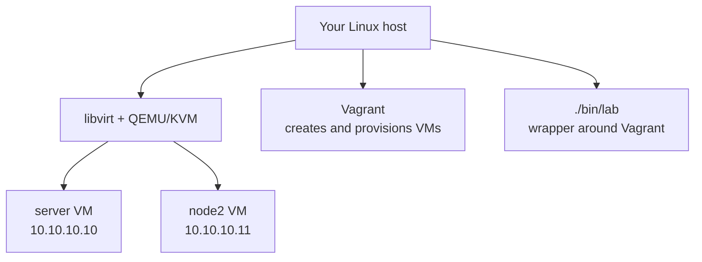

# F2 — The lab: virtualization and first login

<div class="module-meta" markdown>

| | |
|---|---|
| **Time** | 1–2 hours |
| **Prerequisites** | None; [F1 — Linux, open source, and the RHEL family](../f1-linux-rhel-family/index.md) is recommended background |
| **Lab** | Start both VMs, log in, inspect the system, test cross-VM SSH, and use snapshots |
| **Self-check** | At the end of the page |

</div>

The course needs a real system: real `systemd`, real SELinux, real storage, real reboots. A container or a cloud shell is not enough, and a cloud VM costs money and limits what you can break.

The lab gives you two disposable virtual machines on your own Linux host. You can destroy them, rebuild them, and snapshot them without risking your workstation.

This module gets that lab running and teaches the habit that makes the rest of the course safe: **snapshot before you experiment, restore when you break something.**

## What the lab gives you

| Machine | Address | Resources | Role |
|---|---|---|---|
| `server` | `10.10.10.10` | 2 vCPU, 4 GB RAM, 20 GB root + 10 GB `/dev/vdb` | Main practice system |
| `node2` | `10.10.10.11` | 1 vCPU, 2 GB RAM, 20 GB root | SSH, NFS, firewall, and client/server target |

Both machines run AlmaLinux 10, a RHEL 10-compatible rebuild that needs no subscription. The extra `/dev/vdb` disk on `server` is deliberately left unpartitioned for the storage modules.

## The mental model

There are four layers between you and the lab:



| Layer | What it does |
|---|---|
| **KVM / QEMU** | Runs the virtual machines with hardware virtualization |
| **libvirt** | Manages virtual networks, storage, and VM lifecycle |
| **Vagrant** | Creates the VMs from a box, uploads provisioning files, and runs the provisioners |
| **`./bin/lab`** | Wrapper that sets the lab key, runs Vagrant from `labs/`, and adds snapshot and checker commands |

Use `./bin/lab`, not raw `vagrant`, for normal work. The wrapper makes sure the lab SSH key exists and that commands run from the right directory.

## Before you start

You need:

- a Linux host with KVM enabled,
- at least 16 GB of RAM (24 GB is more comfortable),
- at least 40 GB of free disk,
- Vagrant 2.3+ and the `vagrant-libvirt` provider.

The full installation and troubleshooting guide is [Lab setup](../../start-here/lab-setup.md). If you have not installed the stack yet, do that first.

From the repository root:

```bash
cd labs
./bin/lab doctor
```

`doctor` checks for Vagrant, the libvirt provider, `virsh`, KVM access, RAM, disk space, and the lab SSH key. A healthy run ends with:

```text { .no-copy }
==> Result
  Ready. Run ./bin/lab up
```

If it reports a missing item, fix that item before continuing. The error message includes the command or group change you need.

!!! note "Internet access on first boot"
    The lab runs AlmaLinux 10 and installs its base packages from AlmaLinux's online repositories. Your host and both VMs need internet access the first time you run `./bin/lab up`. See [Lab setup](../../start-here/lab-setup.md).

## Start the lab

```bash
./bin/lab up
```

On the first run this downloads the box, creates both VMs, provisions them, and generates the shared lab SSH key. Expect several minutes. Later runs start the existing VMs much faster.

Check the state:

```bash
./bin/lab status
```

You want both machines running:

```text { .no-copy }
Current machine states:

server                    running (libvirt)
node2                     running (libvirt)
```

The `up` command ends with a summary:

```text { .no-copy }
Lab is ready.

  server  10.10.10.10  (vagrant / labuser)
  node2   10.10.10.11  (vagrant / labuser)

Log in:      ./bin/lab ssh
Snapshot:    ./bin/lab snapshot clean
Run a check: ./bin/lab check r01 lab1

Lab user password: labpass
```

## Log in

```bash
./bin/lab ssh
```

You land on `server` as the `vagrant` user:

```text { .no-copy }
[vagrant@server ~]$
```

### `vagrant` versus `labuser`

| User | Password | Access | Use |
|---|---|---|---|
| `vagrant` | `vagrant` | Passwordless sudo | Provisioning and emergency administration |
| `labuser` | `labpass` | Member of `wheel`; normal sudo with password | Day-to-day lab work |

The labs use `labuser`. It gives you a normal account to test permissions, sudo, and ownership against, instead of doing everything as root.

Switch to it with a login shell:

```bash
sudo su - labuser
```

The prompt changes:

```text { .no-copy }
[labuser@server ~]$
```

The `-` matters. `su - labuser` starts a login shell, reads the target user's profile, and resets `HOME`, `PATH` (the directories searched for commands), and the working directory. `su labuser` keeps much of your current environment and can produce confusing `PATH` and permission behavior. Prefer `su -`.

When `labuser` runs `sudo`, it is asked for `labpass`. That is intentional: the labs practice normal sudo, not passwordless root.

## Look around

Run these commands as `labuser` on `server`:

```bash
hostnamectl
ip -brief address
nmcli connection show --active
lsblk
df -h /
findmnt -no FSTYPE /
free -h
getenforce
systemctl is-active firewalld sshd
```

The output varies with the host, but the shape is stable:

| Command | What to look for |
|---|---|
| `hostnamectl` | Static hostname `server`, AlmaLinux 10, kernel version |
| `ip -brief address` | A management address and `10.10.10.10/24` on the private interface |
| `nmcli connection show --active` | A `lab-private` connection carrying the lab address |
| `lsblk` | `vda` for the root disk and `vdb` (10 GB, no mountpoint) on `server` |
| `df -h /` | The root filesystem and its free space |
| `findmnt -no FSTYPE /` | The root filesystem type, normally `xfs` |
| `free -h` | About 4 GB of RAM on `server`, 2 GB on `node2` |
| `getenforce` | `Enforcing` |
| `systemctl is-active firewalld sshd` | `active` for both |

!!! note "Two networks"
    The management interface is the libvirt NAT network that Vagrant uses for SSH. It usually has a `192.168.x.x` address. The private lab network is `10.10.10.0/24` and is configured by provisioning with the NetworkManager profile `lab-private`. The exam-style work uses the `10.10.10.x` addresses. Do not change the management interface.

The unpartitioned `vdb` disk is not a mistake. R6 will ask you to partition it, build LVM on it, create a filesystem, mount it, and prove it survives a reboot.

## Cross-VM SSH

The lab installs a shared SSH key on both machines for `vagrant` and `labuser`, and writes `~/.ssh/config` entries for `server` and `node2`. That is why this works without flags:

```bash
ssh node2
```

You should land on the second machine:

```text { .no-copy }
[labuser@node2 ~]$ hostname
node2
[labuser@node2 ~]$ exit
```

From `node2`, the reverse also works:

```bash
ssh server
```

This matters for the networking, NFS, firewall, and client/server labs. You will not have to stop and configure SSH keys in the middle of a storage exercise.

## Snapshots: the most important habit

A snapshot records the state of both VM disks. If a lab goes wrong, restore the snapshot and start again.

From the **host**, in `labs/`:

```bash
./bin/lab snapshot clean
```

Do this before you start a lab, not after. A snapshot taken halfway through a broken exercise preserves the broken state.

When you need to undo everything:

```bash
./bin/lab restore clean
```

Restoring reverts both VMs to the snapshot. Any changes made after the snapshot are lost. That is the point.

| Command | Effect |
|---|---|
| `./bin/lab snapshot clean` | Save the current state of both VMs as `clean` |
| `./bin/lab restore clean` | Revert both VMs to the `clean` snapshot |
| `./bin/lab halt` | Shut down both VMs, preserving their state |
| `./bin/lab up` | Start them again |
| `./bin/lab reset` | Destroy and rebuild both VMs from scratch |
| `./bin/lab destroy` | Delete both VMs after confirmation |

!!! warning "Snapshots consume disk"
    Each snapshot stores disk data. If the host runs low on space, list and remove old snapshots:

    ```bash
    cd labs
    vagrant snapshot list
    vagrant snapshot delete server <name>
    vagrant snapshot delete node2 <name>
    ```

    Keep the `clean` snapshot unless you are rebuilding the lab.

## The lab workflow

Use the same rhythm for every module:

1. **Start the lab** from the host:

    ```bash
    cd labs
    ./bin/lab up
    ```

2. **Take a clean snapshot** before changing anything:

    ```bash
    ./bin/lab snapshot clean
    ```

3. **Log in and switch to the lab user**:

    ```bash
    ./bin/lab ssh
    sudo su - labuser
    ```

4. **Do the lab.** Read the expected output, run the commands, and inspect the result.

5. **Reboot the VM when the lab asks for it.** This is the persistence test. Run it inside your SSH session on `server`, as `labuser` — not on your host:

    ```bash
    sudo systemctl reboot
    ```

    A reboot is a guest action. Running it on your host restarts your workstation and takes the lab down with it.

    Your SSH session disconnects. Wait 30–60 seconds, then reconnect from **the host**:

    ```bash
    ./bin/lab status
    ./bin/lab ssh
    ```

    If SSH refuses the connection, the VM is still booting. Wait and try again. Do not restore the snapshot yet; the reboot is part of the exercise.

6. **Run the checker** from the host, if the module has one:

    ```bash
    ./bin/lab check r01 lab1
    ```

7. **Restore the clean snapshot** when you are finished, or before starting a different lab — unless that lab says it builds on the previous one. R1's two labs and its challenge are cumulative, so do not restore between them:

    ```bash
    ./bin/lab restore clean
    ```

The reboot step is not optional. The exam requires configurations to survive a reboot, and many beginners lose points because a service was started but not enabled, or a mount was added to the running system but not to `/etc/fstab`.

## Troubleshooting quick hits

| Symptom | Fix |
|---|---|
| `KVM is not available` | Enable virtualization in firmware, load `kvm_intel` or `kvm_amd`, check `/dev/kvm` |
| `Permission denied` talking to libvirt | Add your user to the `libvirt` and `kvm` groups, then log out and back in |
| `Network 10.10.10.10 is not available` | Old vagrant-libvirt state; destroy and rebuild with `./bin/lab destroy && ./bin/lab up` |
| Private IP missing | Inside the VM: `nmcli connection up lab-private`; if the profile is absent, rebuild |
| `ssh node2` fails | Confirm both VMs are running and `~/.ssh/lab_ed25519` exists on both |
| Box download fails | Check network/proxy; prefetch with `vagrant box add almalinux/10 --provider libvirt` |
| Lab is slow or processes are killed | Give the host more RAM or reduce VM memory in the `Vagrantfile` |

The full troubleshooting section is in [Lab setup](../../start-here/lab-setup.md).

## Safety and hygiene

- The lab uses well-known passwords and is not hardened. It is private to your host on `10.10.10.0/24`. Do not expose it to an untrusted network.
- SELinux and firewalld stay enabled unless a lesson is specifically about disabling them.
- The synced folder is disabled. Files inside the VMs are disposable. If you need to copy something in or out, use `scp` with the lab key, for example:

    ```bash
    scp -i labs/keys/lab_ed25519 notes.txt labuser@10.10.10.10:/tmp/
    ```

- Destroy the lab when you are finished with the course. `./bin/lab destroy` deletes both VMs.

## Self-check

Answer first, then open the answer.

### 1. Host and guest

What is the difference between your host and the lab VMs?

??? question "Answer"
    The host is your physical Linux machine. The VMs are guests running under KVM/QEMU and managed by libvirt. Everything you break inside a guest stays inside the guest, and you can rebuild it from a snapshot or from scratch.

### 2. Why two machines

Why does the course use two VMs instead of one?

??? question "Answer"
    Several objectives need a client and a server: SSH, NFS, firewalld, and network services. `node2` acts as the second machine, so you can test a service from the outside instead of only checking it locally.

### 3. Vagrant and `./bin/lab`

What does `./bin/lab` add on top of Vagrant?

??? question "Answer"
    It sets the lab SSH key, runs Vagrant from the `labs/` directory, and adds convenience commands for snapshots, restore, status, and running the module checkers. Use it for normal lab work.

### 4. `vagrant` versus `labuser`

Why do the labs use `labuser` instead of staying as `vagrant`?

??? question "Answer"
    `vagrant` has passwordless sudo, which is convenient for provisioning but unrealistic for permission and sudo exercises. `labuser` is a normal user in `wheel` with a password, so you can practice sudo, ownership, and access control the way the exam expects.

### 5. The two networks

What is the difference between the management address and `10.10.10.10`?

??? question "Answer"
    The management address is on libvirt's NAT network and is used by Vagrant for SSH and provisioning. `10.10.10.10` is the private lab network on the second interface, configured by the `lab-private` NetworkManager profile. The course work uses the `10.10.10.x` network.

### 6. Snapshots

You take a `clean` snapshot, do half a lab, and then restore it. What happens to your work?

??? question "Answer"
    It is lost. Restoring reverts both VM disks to the state they had when the snapshot was taken. That is why you snapshot before starting, and why you run the checker before restoring.

### 7. Reboot persistence

Why does the lab workflow include a reboot?

??? question "Answer"
    The exam requires configurations to survive a reboot. A service that is running but not enabled, a mount that is active but missing from `/etc/fstab`, or a firewall rule that was added without `--permanent` will fail after a reboot. Rebooting is the only honest test.

### 8. Recovering from a mistake

You accidentally delete an important configuration file during a lab. What is the fastest safe recovery?

??? question "Answer"
    From the host, run `./bin/lab restore clean` to revert both VMs to the clean snapshot, then log in again. If the snapshot is gone, rebuild with `./bin/lab reset` and repeat the setup.

## Next

The next foundations module is [F3 — Shell, commands, and the help system](../f3-shell-help/index.md), which teaches you to read command syntax, quote correctly, and find documentation without internet access.
