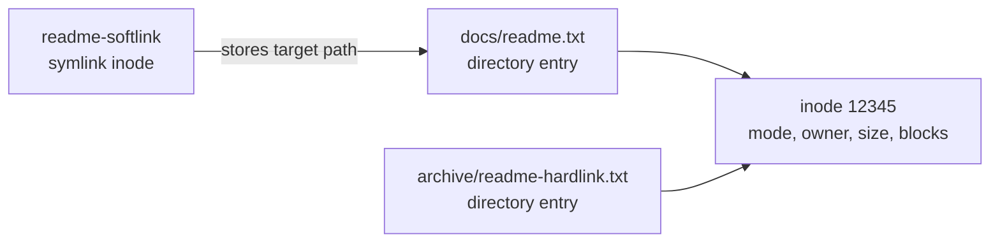
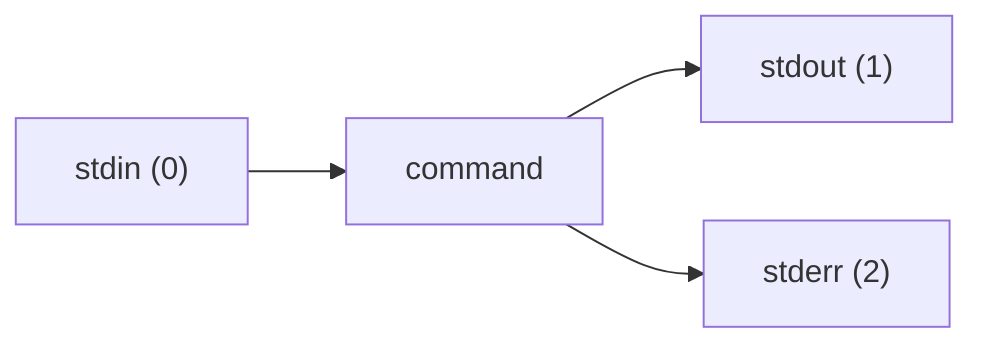

# R1 — Essential tools

<div class="module-meta" markdown>

| | |
|---|---|
| **Exam objective group** | 1 — Understand and use essential tools |
| **Time** | 3–5 hours including labs |
| **Prerequisites** | Basic computer literacy; the lab from [Lab setup](../../start-here/lab-setup.md) |
| **Labs** | 2 guided labs + 1 challenge |
| **Check command** | `./bin/lab check r01 lab1` (also `lab2` and `challenge`) |

</div>

This is the largest objective group on EX200, and the one every other module depends on. It covers the shell, the help system, files and links, permissions, streams, text search, archives, SSH, and switching users.

None of it is trivia. A storage task fails if you cannot read `ls -l` or `stat`. A service task fails if you cannot redirect output or search a log. A security task fails if you do not understand why a parent directory's execute bit matters.

## Objective checklist

By the end of this module you should be able to:

- [ ] Access a shell prompt and issue commands with correct syntax
- [ ] Use input/output redirection (`>`, `>>`, `|`, `2>`, and friends)
- [ ] Use `grep` and regular expressions to analyze text
- [ ] Access remote systems using SSH
- [ ] Log in and switch users in multi-user targets
- [ ] Archive, compress, unpack, and uncompress files using `tar`, `gzip`, and `bzip2`
- [ ] Create and edit text files
- [ ] Create, delete, copy, and move files and directories
- [ ] Create hard and soft links
- [ ] List, set, and change standard ugo/rwx permissions
- [ ] Locate, read, and use system documentation, including `man`, `info`, and `/usr/share/doc`

---

## The shell and command syntax

The **kernel** manages hardware, memory, processes, and the filesystem. The **shell** is an ordinary program that reads your commands, asks the kernel to do the work, and prints the result. `bash` is the default interactive shell on RHEL.

A command line has three parts:

```text { .no-copy }
command   [options]        [arguments]
ls        -l               /var/log
```

- **Options** change behavior. They usually start with `-` (`-l`) or `--` (`--human-readable`).
- **Arguments** are the things the command acts on: files, directories, users, units.
- Options and arguments are separated by **whitespace**. Quoting controls how whitespace and special characters are interpreted.

### Quoting rules

| Form | Behavior | Example |
|---|---|---|
| Unquoted | Shell splits on spaces and expands globs, variables, and command substitution | `rm *.log` |
| Single quotes | Everything is literal | `echo '$HOME'` prints `$HOME` |
| Double quotes | Spaces are protected; variables and command substitution still expand | `echo "Home: $HOME"` |
| Backslash | Escapes the next character | `echo \$HOME` prints `$HOME` |

```bash
echo '$HOME'          # $HOME
echo "$HOME"          # /home/labuser
echo "Today: $(date)" # command substitution
```

### Exit status and command chaining

Every command returns an exit status. `0` means success; anything else means failure.

```bash
ls /etc/hosts
echo $?        # 0

ls /does-not-exist
echo $?        # 2
```

| Operator | Meaning |
|---|---|
| `cmd1 ; cmd2` | Run both, regardless of success |
| `cmd1 && cmd2` | Run `cmd2` only if `cmd1` succeeded |
| `cmd1 \|\| cmd2` | Run `cmd2` only if `cmd1` failed |

This matters in scripts and in one-liners:

```bash
mkdir -p /srv/r1 && cd /srv/r1 && echo "ready"
```

### Finding out what a command is

```bash
type ls             # ls is aliased to `ls --color=auto'
type -a ls          # all matches, including /usr/bin/ls
command -v tar      # the path the shell would execute
```

Use `type` when a command behaves differently than expected. An alias or a function may be intercepting it.

!!! tip "Useful shell habits"
    - `Tab` completes paths and commands.
    - `Ctrl+R` searches your history.
    - `history` lists recent commands; `!42` reruns command 42.
    - `Ctrl+C` cancels the current foreground command.
    - `Ctrl+D` sends end-of-file; at a prompt, it logs you out.

---

## Editing text files

You will edit configuration files constantly, often as root, often on a system with no graphical editor. The exam expects you to create and modify files from the shell.

### Quick and non-interactive

For short content, redirection is enough:

```bash
echo "PermitRootLogin no" > /tmp/example.conf
printf 'line one\nline two\n' > /tmp/example.conf
cat <<'EOF' > /tmp/example.conf
line one
line two
EOF
```

For real configuration files, use an editor. The lab installs `vim-enhanced`.

### vi / vim survival guide

`vim` has modes. If a key does something unexpected, press `Esc` to return to **normal mode**.

| Action | Keys |
|---|---|
| Open a file | `vim file` |
| Insert before the cursor | `i` |
| Append after the cursor | `a` |
| Return to normal mode | `Esc` |
| Save | `:w` |
| Quit | `:q` |
| Save and quit | `:wq` or `ZZ` |
| Quit without saving | `:q!` |
| Delete a line | `dd` |
| Copy a line | `yy` |
| Paste | `p` |
| Undo | `u` |
| Search | `/pattern`, then `n` for the next match |
| Go to the first line | `gg` |
| Go to the last line | `G` |
| Show line numbers | `:set number` |
| Replace all occurrences | `:%s/old/new/g` |

A typical edit:

```bash
sudo vim /etc/hosts
# press i, make the change, press Esc, type :wq and press Enter
```

### nano

`nano` is simpler if it is installed:

```bash
nano file
```

`Ctrl+O` saves, `Ctrl+X` exits. The key hints are displayed at the bottom of the screen. Do not rely on `nano` being present on every system; `vi` is the safe assumption.

!!! tip "Exam habit"
    Before editing a critical file, copy it: `sudo cp /etc/fstab /etc/fstab.bak`. If the edit breaks the boot, you can recover from the backup or from a rescue shell. Also read the file after saving: a misplaced character in `/etc/fstab` is a classic way to make a system unbootable.

---

## Getting help offline

The exam has no internet. The system is your documentation, and Red Hat expects you to use it.

### man pages

```bash
man ls              # section 1: user commands
man 5 passwd        # section 5: file formats
man 8 mount         # section 8: administration commands
man -k password     # search descriptions (same as apropos)
```

| Section | Contents |
|---|---|
| 1 | User commands |
| 2 | System calls |
| 3 | Library functions |
| 5 | File formats and conventions |
| 7 | Miscellaneous (including conventions) |
| 8 | System administration commands |

Navigation inside `man`: `Space` or `Page Down` scrolls, `/pattern` searches, `n` finds the next match, `q` quits.

`man -k` and `apropos` need the manual index. If a search returns nothing, refresh it:

```bash
sudo mandb
```

### Other documentation

```bash
ls --help                 # short option summary
info coreutils            # GNU info pages (if installed)
ls /usr/share/doc         # package documentation
rpm -qd tar               # documents shipped by the tar package
```

`/usr/share/doc` contains READMEs, examples, and license files. `rpm -qd <package>` tells you which documentation files a package installed. Both are available on the exam system.

!!! warning "Do not skip this objective"
    Candidates lose easy points by not checking `man` for syntax. The exam environment provides documentation; using it is expected, not cheating.

---

## Files and directories

Linux presents one unified directory tree. Disks and filesystems are **mounted** onto directories; there are no drive letters.

### The filesystem hierarchy (the short version)

| Path | Purpose |
|---|---|
| `/` | Root of the tree |
| `/etc` | System configuration files |
| `/home` | User home directories |
| `/root` | Root user's home directory |
| `/var` | Variable data: logs, spools, caches, web content |
| `/usr` | Installed software, libraries, documentation |
| `/tmp` | Temporary files, cleaned periodically by `systemd-tmpfiles` |
| `/srv` | Data served by the system (web, FTP, etc.) |
| `/opt` | Optional add-on software |
| `/proc`, `/sys` | Kernel and hardware information (virtual filesystems) |
| `/dev` | Device files |
| `/run` | Runtime state since boot |

### Navigation and file operations

```bash
pwd                       # where am I?
ls -la                    # all files, long format
cd /var/log               # change directory
cd -                      # back to the previous directory
cd ~                      # home directory

mkdir -p ~/fsdemo/{docs,src,archive}
cd ~/fsdemo                # the paths below are relative to this directory
touch docs/readme.txt
cp docs/readme.txt docs/notes.txt
cp -a docs docs-backup     # preserve mode, ownership, timestamps
mv docs/notes.txt archive/
mkdir -p empty-dir
rmdir empty-dir            # only if empty
rm -r docs-backup          # recurse
```

`~/fsdemo` is a scratch tree for this page. The labs build their own tree under `/srv/r1`, so running this does not disturb them.

| Command | Use |
|---|---|
| `cp -r dir1 dir2` | Copy a directory tree |
| `cp -a src dst` | Archive-style copy: preserves attributes and links |
| `mv src dst` | Move or rename |
| `rm -r dir` | Remove a directory and its contents |
| `rm -f file` | Force, no prompt |
| `file path` | Identify the file type |
| `stat path` | Inode number, size, mode, timestamps |
| `find /path -name '*.log'` | Search by name |
| `find /path -type f -size +10M` | Search by type and size |

!!! danger "`rm -rf` is permanent"
    There is no trash can. Be precise with paths, and never run `rm -rf` on a variable or a path you have not checked. A stray space in `rm -rf / some/path` is catastrophic.

### Globbing and hidden files

The shell expands patterns before the command runs:

| Pattern | Matches |
|---|---|
| `*` | Any string, including empty |
| `?` | Exactly one character |
| `[abc]` | One character from the set |
| `[0-9]` | One digit |
| `[!abc]` | One character not in the set |
| `{a,b}` | Brace expansion: `file.{txt,md}` → `file.txt file.md` |

A filename beginning with `.` is hidden from plain `ls`. Use `ls -a` to see it. `.` is the current directory; `..` is the parent.

---

## Hard and symbolic links

A **directory entry** maps a name to an **inode**. The inode holds the file's metadata and points to its data blocks. A filename is not the file; it is a label attached to an inode.



### Hard links

```bash
ln docs/readme.txt archive/readme-hardlink.txt
```

- Both names point to the **same inode**.
- The link count increases. `ls -l` shows `2` in the second column.
- Editing through either name changes the same data.
- Deleting one name does not delete the data until the last link is gone.
- Hard links cannot cross filesystems and cannot normally point to directories.

### Symbolic links

```bash
ln -s docs/readme.txt readme-softlink
```

- The symlink is a **separate inode** whose content is the target path.
- It can point across filesystems and to directories.
- If the target is removed, the link is **dangling** (broken) but the link itself remains.
- `ls -l` shows an `l` type and a `->` target.

### Inspecting links

```bash
ls -li docs/readme.txt archive/readme-hardlink.txt
stat -c '%i %h %n' docs/readme.txt archive/readme-hardlink.txt
readlink readme-softlink
readlink -f readme-softlink      # resolve to an absolute path
find /srv/r1 -samefile docs/readme.txt
```

| Task | Use a hard link when… | Use a symbolic link when… |
|---|---|---|
| Same filesystem | Yes | Either |
| Different filesystem | No | Yes |
| Directory target | No | Yes |
| Survives deleting the original name | Yes | No |
| Clear "this points elsewhere" semantics | No | Yes |

Hard links are useful for deduplicating files and for backup schemes. Symbolic links are everywhere in Linux: `/usr/bin/python3` may point to a versioned binary, and `/etc/localtime` typically points into `/usr/share/zoneinfo`.

---

## Permissions

Every file has an **owner**, a **group**, and a set of permission bits for three classes: **user** (owner), **group**, and **other**.

```text { .no-copy }
-rw-r--r--. 1 labuser labuser 1234 Mar  1 10:00 report.txt
│└┬┘└┬┘└┬┘
│ │  │  └── other: r--
│ │  └───── group: r--
│ └──────── owner: rw-
└────────── file type: - (regular), d (directory), l (symlink)
```

### What r, w, and x mean

| Bit | On a file | On a directory |
|---|---|---|
| `r` | Read the contents | List the names |
| `w` | Modify the contents | Create, delete, or rename entries |
| `x` | Execute the file | Traverse the directory (enter it, access paths inside) |

The directory `x` bit is the one people forget. To open `/srv/r1/secure/report.txt`, you need `x` on `/`, `/srv`, `/srv/r1`, and `/srv/r1/secure` — in addition to `r` on the file.

### Octal notation

Each permission class is a sum:

| Value | Permission |
|---|---|
| 4 | read |
| 2 | write |
| 1 | execute |

```text { .no-copy }
755 = rwx r-x r-x
644 = rw- r-- r--
640 = rw- r-- ---
600 = rw- --- ---
750 = rwx r-x ---
770 = rwx rwx ---
```

```bash
chmod 640 report.txt
chmod u+x run.sh
chmod g-w,o-r report.txt
chmod -R 750 /srv/r1/project   # recursive; be careful
```

`chmod` supports symbolic (`u`, `g`, `o`, `a`; `+`, `-`, `=`) and octal modes. Use symbolic when you are changing one class; use octal when you are setting the whole mode.

### Ownership

```bash
chown labuser report.txt
chown labuser:labuser report.txt
chgrp wheel report.txt
chown -R labuser:labuser /srv/r1
```

Only root can change the owner of a file. The owner can change the group to a group they belong to. `chown -R` follows the tree; check the path before pressing Enter.

### umask

The **umask** subtracts permissions from the default mode when a file is created. Files start from `666` (no execute by default); directories start from `777`.

```bash
umask            # e.g. 0022
umask 027
touch private.txt
stat -c '%a %n' private.txt   # 640
```

| umask | New files | New directories |
|---|---|---|
| `022` | `644` | `755` |
| `027` | `640` | `750` |
| `077` | `600` | `700` |

The umask is a shell setting. To make it persist, set it in `/etc/profile`, `/etc/bashrc`, or a file under `/etc/profile.d/` (R2 covers the configuration side).

### Testing access

```bash
id
namei -l /srv/r1/secure/report.txt   # show permissions on every path component
sudo -u vagrant cat /srv/r1/secure/report.txt
```

`namei -l` is the fastest way to diagnose "permission denied" on a path. If a parent directory lacks `x` for your user, the file's own mode is irrelevant.

---

## Streams, redirection, and pipes

Every process has three standard streams:



| Operator | Effect | Example |
|---|---|---|
| `>` | Redirect stdout, truncate the file | `ls > listing.txt` |
| `>>` | Redirect stdout, append | `echo done >> log.txt` |
| `2>` | Redirect stderr | `cmd 2> errors.txt` |
| `2>>` | Append stderr | `cmd 2>> errors.txt` |
| `&>` | Redirect both stdout and stderr | `cmd &> all.txt` |
| `2>&1` | Send stderr to wherever stdout currently points | `cmd > all.txt 2>&1` |
| `<` | Redirect stdin from a file | `sort < names.txt` |
| `\|` | Pipe stdout into another command's stdin | `grep ERROR app.log \| wc -l` |
| `tee` | Write to a file and stdout | `cmd \| tee output.txt` |

### Order matters

```bash
cmd > all.txt 2>&1     # both streams go to all.txt
cmd 2>&1 > all.txt     # stderr goes to the terminal, stdout to all.txt
```

Redirections are processed left to right. In the second command, `2>&1` points stderr at the terminal (where stdout currently points), then `>` moves stdout to the file. This is a classic exam trap. Memorize the correct order: **redirect stdout first, then point stderr at it**.

### Useful patterns

```bash
command > /dev/null 2>&1        # discard all output
grep ERROR app.log | tee errors.txt | wc -l
cat <<'EOF' > notes.txt
Line one
Line two
EOF
```

A heredoc (`<<EOF`) feeds multiple lines to a command's stdin. Quoting the delimiter (`<<'EOF'`) prevents variable expansion inside the block.

### Pipes

A pipe connects the stdout of one command to the stdin of the next. This is the heart of the Unix toolset:

```bash
ps aux | grep sshd | grep -v grep
ss -tulpn | sort -k5
cut -d: -f1 /etc/passwd | sort | uniq -c | sort -nr | head
```

Each command does one small job. The pipeline does the real work.

---

## grep and regular expressions

`grep` prints lines that match a pattern. It is the most useful text tool on the exam.

```bash
grep ERROR app.log              # literal match
grep -i error app.log           # case-insensitive
grep -v ERROR app.log           # invert: lines that do NOT match
grep -n ERROR app.log           # show line numbers
grep -c ERROR app.log           # count matching lines
grep -r pattern /etc            # recursive
grep -E 'ERROR|WARN' app.log    # extended regex: alternation
grep -oE '[0-9]{1,3}(\.[0-9]{1,3}){3}' app.log  # print only the match
```

### Regex essentials

| Pattern | Matches |
|---|---|
| `.` | Any single character |
| `*` | Zero or more of the previous item |
| `+` | One or more (ERE) |
| `?` | Zero or one (ERE) |
| `^` | Start of line |
| `$` | End of line |
| `[abc]` | One character from the set |
| `[^abc]` | One character not in the set |
| `[a-z]` | One character in the range |
| `\|` | Alternation (ERE; `\|` in BRE) |
| `(...)` | Grouping (ERE; `\(...\)` in BRE) |
| `{n,m}` | Between n and m repetitions (ERE) |
| `\b` | Word boundary (GNU grep) |

There are two dialects:

- **Basic regular expressions (BRE)** — the default. `+`, `?`, `|`, `()`, and `{}` are literal unless escaped.
- **Extended regular expressions (ERE)** — enabled with `grep -E` (or `egrep`). Those metacharacters work without backslashes.

When in doubt, use `grep -E`. It matches what most people expect.

### Examples

Given a log line:

```text { .no-copy }
2026-01-01 10:00:03 ERROR failed to connect to 10.0.0.5
```

```bash
grep '^2026-01-01' app.log              # lines starting with the date
grep 'ERROR.*10\.0\.0\.5' app.log       # ERROR followed by that IP
grep -E 'ERROR|WARN' app.log            # either level
grep -oE '([0-9]{1,3}\.){3}[0-9]{1,3}' app.log  # extract IPv4 addresses
```

The last pattern is the one used in Lab 2. Note the escaped dots: an unescaped `.` matches any character, which would also match `10x0x0x5`.

!!! tip "Quote your patterns"
    Put regex patterns in single quotes. Otherwise the shell may expand `*`, `?`, or `$` before `grep` sees them.

---

## Archives and compression

`tar` bundles files into a single archive. `gzip` and `bzip2` compress a stream. `tar` can call them for you.

### Create, list, extract

These are patterns, not a session. `project/` is a placeholder for a directory you own, and each line writes or reads `project.tar.gz` in the current directory — so run one at a time and replace the names. The last line also needs `/tmp/restore` to exist. The copy button is intentionally absent for that reason.

```bash { .no-copy }
tar -czf project.tar.gz project/       # create, gzip
tar -cjf project.tar.bz2 project/      # create, bzip2
tar -cf project.tar project/           # create, no compression
tar -tzf project.tar.gz                # list contents
tar -xzf project.tar.gz                # extract
tar -xzf project.tar.gz -C /tmp/restore  # extract into a directory
```

The option letters:

| Letter | Meaning |
|---|---|
| `c` | Create |
| `x` | Extract |
| `t` | List |
| `f` | Archive file follows (must be last before the filename) |
| `v` | Verbose |
| `z` | gzip |
| `j` | bzip2 |
| `J` | xz |
| `C` | Change to directory before operating |

The `f` option takes the archive name as its argument. `tar -czf archive.tar.gz dir` is correct; `tar -czvf dir archive.tar.gz` is not.

### Standalone compressors

`file` is a placeholder, and each line consumes it: after `gzip file`, the original is gone and `gzip file` again fails. Try these on a scratch copy.

```bash { .no-copy }
gzip file              # file -> file.gz, removes the original
gzip -k file           # keep the original
gunzip file.gz
bzip2 file
bunzip2 file.bz2
zcat file.gz           # decompress to stdout
bzcat file.bz2
```

!!! warning "List before you extract"
    Extract archives into an empty directory, or list them first with `tar -tf`. A malicious or careless archive can overwrite files in your current directory. Never extract an untrusted archive as root.

---

## SSH and secure file transfer

`ssh` opens an encrypted session to a remote system. The lab has two machines specifically so you can practice this.

```bash { .no-copy }
ssh labuser@10.10.10.11              # log in to node2
ssh labuser@10.10.10.11 hostname     # run one command and exit
ssh -p 2222 labuser@host             # non-default port
```

The first two work against this course's lab. The third is a pattern: `host` and the port are placeholders, and no such server exists here.

The first connection asks you to verify the host key fingerprint. Accepting adds the host to `~/.ssh/known_hosts`. If a host key changes unexpectedly, SSH refuses to connect — that is a security feature, not a bug. Remove the stale entry with:

```bash
ssh-keygen -R 10.10.10.11
```

### Copying files

`report.txt` and `project/` are placeholders for a file and a directory you have. Create them first, or substitute names that exist.

```bash { .no-copy }
scp report.txt labuser@10.10.10.11:/home/labuser/
scp -r project/ labuser@10.10.10.11:/home/labuser/
scp labuser@10.10.10.11:/home/labuser/report.txt .
sftp labuser@10.10.10.11
```

The remote path uses a colon: `host:path`. A missing colon is the most common `scp` mistake — it turns the remote path into a local filename.

`rsync -av source/ user@host:/dest/` is often better for large or repeated transfers because it copies only changes. It is not required for RHCSA, but it is worth knowing.

### Key-based authentication (preview)

R10 covers this in detail. The shape is:

```bash
ssh-keygen -t ed25519
ssh-copy-id labuser@10.10.10.11
ssh labuser@10.10.10.11
```

The private key stays on the client (`~/.ssh/id_ed25519`, mode `600`); the public key is appended to `~/.ssh/authorized_keys` on the server. File and directory permissions matter: SSH refuses keys or directories that are group- or world-writable.

---

## Switching users and privilege

`command` below stands for a real command such as `dnf update`; `su - labuser` and `sudo -l` work as written on the lab.

```bash { .no-copy }
id                     # uid, gid, groups
whoami                 # effective username
su - labuser           # start a login shell as labuser (asks for labuser's password)
su - labuser -c 'id'   # run one command as labuser
sudo command           # run one command as root (asks for your password)
sudo -i                # interactive root login shell
sudo -u labuser command
sudo -l                # what may I run with sudo?
```

| | `su` | `sudo` |
|---|---|---|
| Password | Target user's | Your own |
| Authorization | Knowing the target password | Membership in `sudoers` |
| Environment | `su -` gives a login shell | `sudo -i` gives a login shell |
| Audit | Less granular | Logged per command |
| Typical use | Switch to another account | Run one privileged command |

`su -` (with the hyphen) starts a **login shell**: it reads the target user's profile, sets `HOME`, `PATH`, and the working directory. `su` without the hyphen keeps the current environment, which often causes confusing `PATH` problems. Use `su -` unless you have a reason not to.

On the lab systems, `labuser` is a member of `wheel`, so `sudo` works with the password `labpass`. `vagrant` has passwordless sudo for provisioning, but the labs use `labuser` for day-to-day work.

---

## Exam lens

The exam tests these skills inside larger tasks. Watch for these traps:

1. **Persistence.** Files and permissions persist by themselves. Services, mounts, firewall rules, and SELinux settings do not. Always ask: "What makes this survive a reboot?"
2. **Quoting.** A glob or a variable in an unquoted argument may expand in a way you did not intend. Quote paths with spaces and regex patterns.
3. **Directory execute permission.** "Permission denied" on a file often means a parent directory lacks `x` for your user. Run `namei -l`.
4. **Hard link vs symlink.** Hard links cannot cross filesystems or point to directories. Symlinks can, but they break if the target moves.
5. **Redirection order.** `> file 2>&1` is not the same as `2>&1 > file`.
6. **`tar` option order.** `-f` takes the archive name; put it immediately before the filename.
7. **`scp` colon syntax.** `host:path`, not `host/path`.
8. **man sections.** `man 5 passwd` (file format) is different from `man 1 passwd` (command). Use `man -k` when you do not know the section.
9. **`rm -rf`.** There is no undo. Check the path twice.
10. **Read the task.** "Create a symbolic link" and "create a hard link" are different tasks. "Make it persistent" means more than running the command.

---

## Check yourself

<details>
<summary>1. What is the difference between a hard link and a symbolic link?</summary>

A hard link is another directory entry for the same inode; the data is shared and the link count increases. It cannot cross filesystems or normally point to a directory. A symbolic link is a separate file containing a path to the target; it can cross filesystems and point to directories, but it breaks if the target is removed.

</details>

<details>
<summary>2. What does <code>chmod 640 report.txt</code> allow?</summary>

Owner `labuser` (or whoever owns it) can read and write; group members can read; everyone else has no access. The parent directories must allow traversal for anyone to reach the file.

</details>

<details>
<summary>3. Why does <code>cmd 2>&1 &gt; all.txt</code> send stderr to the terminal?</summary>

Redirections are applied left to right. `2>&1` makes stderr point to the current stdout (the terminal). Then `>` moves stdout to the file, but stderr still points to the terminal. Use `cmd > all.txt 2>&1`.

</details>

<details>
<summary>4. How do you list the contents of a <code>.tar.gz</code> without extracting?</summary>

`tar -tzf archive.tar.gz`. The `t` lists, `z` handles gzip, and `f` names the archive.

</details>

<details>
<summary>5. What does <code>umask 027</code> produce for a new file and a new directory?</summary>

Files start from `666` minus `027` → `640`. Directories start from `777` minus `027` → `750`.

</details>

<details>
<summary>6. How do you run one command as another user without starting an interactive shell?</summary>

`sudo -u labuser command` (if you have sudo rights) or `su - labuser -c 'command'` (with the target user's password).

</details>

<details>
<summary>7. Which command shows the inode number and link count of two files?</summary>

`ls -li file1 file2` or `stat -c '%i %h %n' file1 file2`. The inode is the first column of `ls -li`; the link count is the second.

</details>

<details>
<summary>8. How do you extract only the IPv4 addresses from a log file?</summary>

`grep -oE '([0-9]{1,3}\.){3}[0-9]{1,3}' app.log`. The `-o` prints only the match, and `-E` enables extended regex. Add `| sort -u` to deduplicate.

</details>

---

## Labs

Now put it together on the lab systems:

1. [Lab 1 — Files and links](labs/lab-1-files-and-links.md)
2. [Lab 2 — Streams and permissions](labs/lab-2-streams-and-permissions.md)
3. [Challenge — Handoff bundle](labs/challenge-handoff.md)

Then review the [knowledge check](quiz.md) and keep the [cheat sheet](cheatsheet.md) handy.
