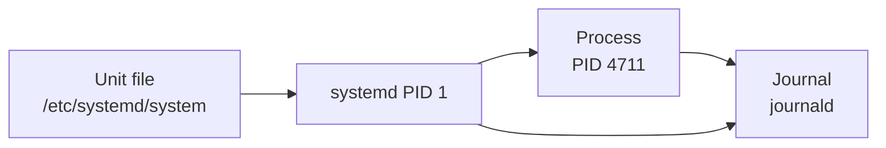

# R5 — Processes and services

<div class="module-meta" markdown>

| | |
|---|---|
| **Exam objective group** | 4 — Operate running systems |
| **Time** | 3–4 hours including labs |
| **Prerequisites** | [R1 — Essential tools](../r01-essential-tools/index.md), especially [Streams and pipes](../r01-essential-tools/index.md#streams-redirection-and-pipes), and [F7 — Processes, systemd, logs](../../foundations/f7-processes-systemd/index.md) |
| **Labs** | 2 guided labs + 1 challenge |
| **Check command** | `./bin/lab check r05 lab1` (also `lab2` and `challenge`) |

</div>

A running Linux system is a collection of **processes** and the **services** that keep them running. This module is about the second half of that sentence: how to find a process, how to change how much CPU it gets, how to stop it, and how to make a program come back by itself after a reboot, a crash, or a mistake.

The exam's group 4 asks for four things here: processes, tuning profiles, journals, and services. They look unrelated until you see that a service is just a process that systemd starts, watches, and writes about. Once you can read a unit file, follow a process into the journal, and change a tuning profile, the four objectives are one workflow.

## Objective checklist

By the end of this module you should be able to:

- [ ] Find a process and read its PID, parent, state, and nice value
- [ ] Explain what `nice` and `renice` change, and in which direction
- [ ] Send the right signal with `kill`/`pkill`, and say why `SIGKILL` is a last resort
- [ ] Read and write a systemd unit file, including a drop-in
- [ ] Explain the difference between `start`, `enable`, and `mask`
- [ ] Make a service run now and after a reboot, and prove it
- [ ] Read the journal with `journalctl`, and make it survive a reboot
- [ ] Cap the size of the journal with a drop-in
- [ ] Inspect the active `tuned` profile and switch it
- [ ] Show that all of it survives a reboot

---

## Processes

A **process** is a running program: the program's code in memory, its data, its open files, and a kernel record describing it. Every process has a **PID** and a **parent** (PPID). The kernel starts one process at boot, PID 1, and every other process descends from it.

```bash
ps -o pid,ppid,ni,stat,comm -p 1
```

```text
    PID    PPID  NI STAT COMMAND
      1       0   0 Ss   systemd
```

- `PPID` 0 means "no parent" — PID 1 is where the tree starts.
- `NI` is the **nice value**, covered below.
- `STAT` is the state.

### `ps` in three useful shapes

| Command | Shows |
|---|---|
| `ps` | Your own processes, in the current terminal |
| `ps aux` | Every process, with CPU and memory percentages |
| `ps -ef` | Every process, with UID and full command line |
| `ps -o pid,ni,comm` | Exactly the columns you asked for |
| `ps -e --sort=-%cpu \| head` | The busiest processes first |
| `ps -p 1234 -o pid,ppid,etime,args` | One process, in detail |

The defaults differ between systems. When you write a script or read a check, ask for the columns explicitly with `-o`; that output is stable.

### States

The `STAT` column is one letter, sometimes followed by a modifier:

| Code | Meaning |
|---|---|
| `R` | Running or runnable |
| `S` | Sleeping, waiting for an event (most processes, most of the time) |
| `D` | Uninterruptible sleep, usually waiting for I/O |
| `T` | Stopped (Ctrl-Z, or `SIGSTOP`) |
| `Z` | Zombie: finished, but its parent has not collected the exit status |
| `I` | Idle kernel thread |

A trailing `s` means session leader, `l` means multi-threaded, `+` means in the foreground.

```bash
ps -eo pid,ni,stat,comm --sort=-pcpu | head -6
```

```text
    PID  NI STAT COMMAND
    996   0 Ss   systemd
   1023   0 Ss   sshd-session
      1   0 Ss   systemd
    701   0 Ssl  firewalld
     31   0 I    kworker/u10:1-events_unbound
```

Sorting by CPU on an idle VM shows the busiest of a quiet system. On a sick machine the same command puts the culprit at the top, which is half of "identify CPU/memory intensive processes". `top` does the same thing live: `P` sorts by CPU, `M` by memory, `k` kills, `r` renices, `q` quits.

### Finding a process without a GUI

| Command | Finds |
|---|---|
| `pgrep sshd` | PIDs whose name matches |
| `pgrep -a sshd` | PID and command line |
| `pgrep -u labuser` | Everything a user runs |
| `pgrep -f 'worker heartbeat'` | Match the full command line |
| `pidof sshd` | All PIDs for an exact program name |

```bash
pgrep -a sshd
```

```text
899 sshd: /usr/sbin/sshd -D [listener] 0 of 10-100 startups
1023 sshd-session: labuser [priv]
1026 sshd-session: labuser@notty
```

`-f` matches the whole command line, which is how you find a process whose name says nothing (`bash`, `python3`).

## Signals

A signal is a small message to a process. Most are requests, and a program can catch them, ignore them, or act on them. The `kill` command sends one; it does **not** necessarily kill.

```bash
kill -l | head -8
```

```text
 1) SIGHUP	 2) SIGINT	 3) SIGQUIT	 4) SIGILL	 5) SIGTRAP
 6) SIGABRT	 7) SIGBUS	 8) SIGFPE	 9) SIGKILL	10) SIGUSR1
11) SIGSEGV	12) SIGUSR2	13) SIGPIPE	14) SIGALRM	15) SIGTERM
16) SIGSTKFLT	17) SIGCHLD	18) SIGCONT	19) SIGSTOP	20) SIGTSTP
```

| Signal | Number | What it means |
|---|---|---|
| `SIGHUP` | 1 | "Reload your configuration" for many daemons |
| `SIGINT` | 2 | What Ctrl-C sends |
| `SIGKILL` | 9 | Die **now**. Cannot be caught, blocked, or ignored |
| `SIGTERM` | 15 | "Please exit". The default, and the polite one |
| `SIGSTOP` / `SIGCONT` | 19 / 18 | Pause / resume |

```bash
kill -TERM 1234        # the same as kill 1234
kill -9 1234           # last resort
```

Always try `SIGTERM` first. A program that receives it can finish its work, close files, and remove its lock. `SIGKILL` gives it no chance, and a database or a mail server killed that way can leave state that takes an hour to repair. If `SIGTERM` did nothing after a few seconds, then escalate.

By name instead of by number:

```bash
pkill -TERM worker        # every process named worker
pkill -f 'r5-worker'      # match the command line
killall sleep             # by exact program name
```

!!! warning "`pkill -f` matches your own shell"
    The pattern is matched against every command line, including the `pkill` itself and the shell that ran it. `pkill -f bash` can end your session. Add `-u` to limit it to a user, or check the list first with `pgrep -af`.

## Scheduling priority: nice

The scheduler decides which runnable process gets the CPU. **Nice** is the knob you turn to influence that decision. Values run from **-20** (least nice: takes priority) to **19** (most nice: yields to others). The default is **0**.

Only root can give a process a *lower* nice value, because that is the direction that takes CPU away from everyone else. Any user can be *nicer*.

| Command | Effect |
|---|---|
| `nice -n 10 command` | Start `command` with nice 10 |
| `sudo renice -n 5 -p 1234` | Change a running process to nice 5 |
| `ps -o pid,ni,comm -p 1234` | Read the value back |
| `top` then `r` | Renice interactively |

```bash
nice -n 5 sleep 60 &
```

```text
[1] 1054
```

```bash
ps -o pid,ni,comm -p 1054
renice -n 15 -p 1054
ps -o pid,ni,comm -p 1054
```

```text
    PID  NI COMMAND
   1054   5 sleep
1054 (process ID) old priority 5, new priority 15
    PID  NI COMMAND
   1054  15 sleep
```

A background job started with `&` is still a child of your shell; `$!` is its PID, which saves typing in a script:

```bash
nice -n 5 sleep 300 &
ps -o ni= -p $!
```

Nice does not limit anything. It is a hint to the scheduler, and on an idle machine a nice 19 process still runs at full speed. It matters when the CPU is contended: a backup job at nice 19 lets an interactive session stay responsive.

## systemd: units, services, and state

systemd is PID 1. It starts services, watches them, restarts them, and records what happened in the journal. It learns what to do from **unit files**.



### Unit types you will meet

| Suffix | Unit kind | Example |
|---|---|---|
| `.service` | A long-running or one-shot process | `sshd.service` |
| `.socket` | An endpoint that starts a service on demand | `sshd.socket` |
| `.timer` | A schedule, like cron (R8) | `logrotate.timer` |
| `.target` | A group of units, like a runlevel (R11) | `multi-user.target` |
| `.mount` | A mounted filesystem (R6) | `boot.mount` |
| `.path` | Watch a file or directory | `systemd-ask-password.path` |

### A service unit file

```ini
[Unit]
Description=R5 worker (heartbeat)

[Service]
ExecStart=/usr/local/bin/r5-worker

[Install]
WantedBy=multi-user.target
```

| Section | What belongs there |
|---|---|
| `[Unit]` | Description, ordering (`After=`), dependencies (`Requires=`, `Wants=`) |
| `[Service]` | `ExecStart=`, `Restart=`, `Nice=`, `User=`, `Type=` |
| `[Install]` | What `enable` does: usually `WantedBy=multi-user.target` |

`[Install]` is empty for a unit that should never be enabled, such as a helper started by another unit.

### Where unit files live

| Directory | Who owns it | Survives package update |
|---|---|---|
| `/usr/lib/systemd/system/` | The package manager | Yes, until the package changes |
| `/etc/systemd/system/` | The administrator | Yes |
| `/run/systemd/system/` | Transient, generated at boot | No |

Put your own units in `/etc/systemd/system/`, and never edit a vendor unit in `/usr/lib`; the next update overwrites it. If you need to change a vendor unit, use a **drop-in** (below) or copy the file to `/etc` and edit the copy.

### `start`, `enable`, `mask`

These three are the ones people mix up, because `start` *looks* like it means "turn on".

| Command | What it changes | Survives reboot |
|---|---|---|
| `systemctl start foo` | The **running** state now | No |
| `systemctl enable foo` | A symlink in a `.wants/` directory | Yes (starts at boot) |
| `systemctl enable --now foo` | Both | Yes, and running now |
| `systemctl disable foo` | Removes the symlink | The unit can still be started by hand |
| `systemctl mask foo` | Symlink to `/dev/null` | The unit cannot start **at all** |
| `systemctl unmask foo` | Removes the mask | — |

`enable` is just a symlink. Look at what it creates:

```text
Created symlink '/etc/systemd/system/multi-user.target.wants/r5-worker.service' → '/etc/systemd/system/r5-worker.service'.
```

"Start this unit when the system reaches `multi-user.target`" is the whole meaning of enabled.

`mask` is stronger than `disable`. A disabled unit can still be started by hand, or pulled in by a dependency. A masked unit is a symlink to `/dev/null`, so systemd has nothing to load and refuses:

```text
Failed to start r5-scratch.service: Unit r5-scratch.service is masked.
```

That is how you make a service *stay* off, even when a package or another unit wants it.

### `daemon-reload`

systemd reads unit files into memory. After you edit one, it is still running the old copy:

```bash
systemctl daemon-reload
```

You need this after **creating, editing, or deleting** a unit file or a drop-in. You do not need it after `enable` or `start`, because those go through systemd itself. If you forget, `systemctl status` warns that the unit file changed on disk, and your change seems to do nothing.

### Drop-ins: change part of a unit without copying it

A drop-in is a small file in `<unit>.d/` that adds or overrides settings:

```text
/etc/systemd/system/r5-worker.service.d/nice.conf
```

```ini
[Service]
Nice=10
```

The effective unit is the vendor or admin unit file **plus** every drop-in, applied in filename order. That is why drop-ins are numbered (`10-size.conf`, `90-local.conf`) when order matters. Use one when the original unit belongs to a package, or when you want your change to be visible as a separate file.

```bash
systemctl cat r5-worker
```

```text
# /etc/systemd/system/r5-worker.service
[Unit]
Description=R5 worker (heartbeat)

[Service]
ExecStart=/usr/local/bin/r5-worker

[Install]
WantedBy=multi-user.target

# /etc/systemd/system/r5-worker.service.d/nice.conf
[Service]
Nice=10
```

`systemctl cat` prints the whole stack in the order systemd applies it. It is the fastest way to answer "what is this unit actually running?"

### Reading `systemctl status`

```bash
systemctl status r5-worker --no-pager --lines=2
```

```text
● r5-worker.service - R5 worker (heartbeat)
     Loaded: loaded (/etc/systemd/system/r5-worker.service; enabled; preset: disabled)
    Drop-In: /etc/systemd/system/r5-worker.service.d
             └─nice.conf
     Active: active (running) since Tue 2026-11-10 18:28:13 UTC; 1min 5s ago
   Main PID: 705 (r5-worker)
      Tasks: 2 (limit: 24625)
     Memory: 752K (peak: 1.2M)
        CPU: 57ms
     CGroup: /system.slice/r5-worker.service
             ├─705 /bin/bash /usr/local/bin/r5-worker
             └─990 sleep 10

Nov 10 18:29:03 server r5-worker[705]: worker heartbeat 18:29:03
Nov 10 18:29:13 server r5-worker[705]: worker heartbeat 18:29:13
```

- **Loaded** tells you which file was used and whether it is enabled.
- **Drop-In** lists the extra files.
- **Active** is the current state; `failed` names the result.
- **Main PID** is the process systemd considers the service.
- **CGroup** is the whole process tree the unit owns. Killing the main PID is not the same as stopping the unit, because the unit owns the group.
- The last lines are journal entries, so you often do not need a separate `journalctl` call.

### The verbs you will use

| Task | Command |
|---|---|
| Start / stop / restart | `systemctl start foo` / `stop` / `restart` |
| Re-read configuration | `systemctl reload foo` (if the unit supports it) |
| Ask the state | `systemctl is-active foo`, `systemctl is-enabled foo` |
| Full state, machine-readable | `systemctl show foo`, `systemctl show -p Nice --value foo` |
| Unit file and drop-ins | `systemctl cat foo` |
| All loaded units | `systemctl list-units --type=service` |
| All installed unit files | `systemctl list-unit-files --state=enabled` |
| Recent failures | `systemctl --failed` |
| Signal one process in the unit | `systemctl kill -s TERM --kill-whom=main foo` |

`is-active` and `is-enabled` are designed for scripts: they print one word and set the exit status. `active` and `enabled` exit 0; anything else exits non-zero. That is why they appear in checkers.

## A program's location is part of the configuration

On RHEL, SELinux labels files with a **type**, and systemd runs as a type (`init_t`) that may only execute files labelled `bin_t`. A program under `/srv` is labelled `var_t`, so a unit that points there fails at start with `status=203/EXEC` — the same message as "file not found", which is why it wastes so much time:

```text
Process: 14646 ExecStart=/srv/r5/bin/worker (code=exited, status=203/EXEC)
(worker)[14646]: r5-worker.service: Failed at step EXEC spawning /srv/r5/bin/worker: Permission denied
```

`ls -Z` shows the difference:

```text
unconfined_u:object_r:var_t:s0 /srv/r5/bin/worker
system_u:object_r:bin_t:s0 /usr/local/bin/r5-worker
```

`/usr/local/bin` is the right home for an administrator's own programs: it is in everyone's `PATH`, it is labelled `bin_t`, and it survives reboots. Lab 1 walks into the failure first, because that is how you will meet it in the exam.

SELinux is module R10; for now, remember the shape: **203/EXEC plus a working program means look at the label, not the path.**

## The journal

systemd's logging daemon, `journald`, collects:

- kernel messages,
- everything sent to the syslog socket (including `logger`),
- and the **stdout and stderr of every service**.

You read it with `journalctl`.

### Two possible homes

| Directory | Storage | Survives reboot |
|---|---|---|
| `/run/log/journal` | tmpfs, in memory | No |
| `/var/log/journal` | Disk | Yes |

The default is `Storage=auto`: if `/var/log/journal` exists, the journal is persistent; if it does not, the journal is volatile and your logs vanish at the next boot. On a fresh install the directory is often absent, which is why "preserve system journals" is an exam objective at all.

```bash
mkdir -p /var/log/journal
systemctl restart systemd-journald
journalctl --flush
```

`--flush` moves the current entries from `/run` to disk. After that, `ls /var/log/journal` shows a directory named after the machine ID, and inside it the `.journal` files.

### Reading it

| Filter | Shows |
|---|---|
| `journalctl` | Everything, newest at the bottom |
| `journalctl -b` | This boot only |
| `journalctl -b -1` | The previous boot |
| `journalctl --list-boots` | Every boot the journal knows about |
| `journalctl -u r5-worker` | One unit |
| `journalctl -t r5-journal` | One syslog tag, as set by `logger -t` |
| `journalctl -p err` | Priority `err` and worse |
| `journalctl --since "10 min ago"` | By time |
| `journalctl -f` | Follow, like `tail -f` |
| `journalctl -n 20` | The last 20 lines |
| `journalctl -o short-iso` | ISO timestamps |
| `journalctl -o json` | One JSON object per line, for scripts |

Priorities, from most to least severe: `emerg` 0, `alert` 1, `crit` 2, `err` 3, `warning` 4, `notice` 5, `info` 6, `debug` 7. `-p err` therefore means "3 and below", not "exactly 3".

```bash
journalctl -t r5-journal --no-pager
```

```text
Nov 10 05:47:21 server r5-journal[14002]: journal persistence marker
```

`logger` writes a line with a tag of your choosing, which is the simplest way to prove that a persistent journal is really persistent: write a marker, reboot, and search for it again.

### Size limits

The journal grows until something stops it. The cap lives in `journald.conf`:

```bash
systemd-analyze cat-config systemd/journald.conf
```

That prints the **merged** configuration: the main file with every drop-in applied. Reading `/etc/systemd/journald.conf` alone can mislead you, because a drop-in may have overridden the value.

| Setting | Meaning |
|---|---|
| `SystemMaxUse=` | Hard cap on disk use |
| `SystemKeepFree=` | Free space to leave on the filesystem |
| `MaxRetentionSec=` | Drop entries older than this |
| `Storage=` | `auto`, `volatile`, or `persistent` |

```ini
# /etc/systemd/journald.conf.d/10-size.conf
[Journal]
SystemMaxUse=100M
```

`systemctl restart systemd-journald` applies it. To reclaim space immediately, `journalctl --vacuum-size=100M` or `--vacuum-time=2weeks` deletes **archived** journal files; it will not shrink the file currently being written, so `journalctl --rotate` first when you need the space back now.

## tuned

`tuned` is a daemon that applies a bundle of kernel and system settings called a **profile**. A virtual machine, a database server, and a laptop want different values for the same knobs, and a profile is the supported way to switch between them.

```bash
tuned-adm active
```

```text
Current active profile: virtual-guest
```

| Task | Command |
|---|---|
| Show the active profile | `tuned-adm active` |
| List what is available | `tuned-adm list` |
| Ask what it recommends | `tuned-adm recommend` |
| Switch profile | `tuned-adm profile throughput-performance` |
| Turn tuning off | `tuned-adm off` |

The choice is written to `/etc/tuned/active_profile`, and the daemon re-applies it at boot. `tuned` itself must be running and enabled, which the base lab already is:

```bash
systemctl is-enabled tuned
```

```text
enabled
```

`tuned-adm recommend` suggests a profile based on the detected platform — `virtual-guest` on the lab VMs. Switching to `throughput-performance` is a deliberate override: it is a valid profile, it applies immediately, and it comes back after a reboot.

## What survives a reboot

| Thing | Survives? | Why |
|---|---|---|
| The process | No | Memory is cleared |
| A `renice` you applied by hand | No | It dies with the process |
| A unit file in `/etc/systemd/system` | Yes | It is a file |
| A drop-in | Yes | It is a file |
| An `enable` symlink | Yes | It is a symlink in `.wants/` |
| A `mask` symlink | Yes | It points at `/dev/null` |
| A service that is running but not enabled | No | Nothing starts it at boot |
| `/var/log/journal` and the journal files | Yes | They are on disk |
| A `journald.conf` drop-in | Yes | It is a file |
| The `tuned` profile | Yes | Written to `/etc/tuned/active_profile` |
| A marker written with `logger` | Yes, if the journal is persistent | It is in a journal file |

This table is the module's real lesson. Every objective in group 4 has a "now" and a "after reboot" version, and the exam tests the second one.

## Traps worth memorising

| Trap | Symptom | Fix |
|---|---|---|
| `systemctl start` without `enable` | Works until the reboot | `systemctl enable --now foo` |
| `systemctl enable` without `--now` | Enabled, not running | Add `--now`, or `start` it |
| Editing a unit without `daemon-reload` | Change has no effect; status warns about the unit file | `systemctl daemon-reload` |
| `mask` on a unit whose file is in `/etc/systemd/system` | `Failed to mask unit: File ... already exists` | `disable`, remove the file, `daemon-reload`, then `mask` |
| `ExecStart` pointing into `/srv` | `status=203/EXEC`, "Permission denied" | Put the program in `/usr/local/bin` |
| Killing a service's main process | `SIGTERM` leaves it `inactive (dead)`; `SIGKILL` leaves it `failed` | Try `SIGTERM`; use `Restart=` if it must come back |
| `kill -9` first | No cleanup, no log line explaining the exit | Try `SIGTERM`, then escalate |
| `journalctl` without a persistent journal | Logs gone after reboot | `mkdir /var/log/journal`, restart, `--flush` |
| Reading `/etc/systemd/journald.conf` only | You see a value that a drop-in overrode | `systemd-analyze cat-config systemd/journald.conf` |
| `journalctl --vacuum-size` with only active files | "freed 0B" | `journalctl --rotate` first |
| `pkill -f bash` | Your own session dies | Check with `pgrep -af` first |
| `renice` without `-p` | It tries to run a command | `renice -n 5 -p PID` |

## How the checker works

The R5 checker reads live system state, the way the R2 and R3 checkers do — there is no file tree to redirect. It asks systemd what it thinks (`is-enabled`, `is-active`, `show -p Nice`), reads the process's real nice value with `ps`, reads the journal, and asks `tuned-adm` for the active profile.

One check is behavioural: the challenge requires a service that restarts itself, so the checker kills its main process and waits for systemd to bring it back with a new PID. A `Restart=always` in a unit file that does not work is not worth much.

Two checks in Lab 2 only pass **after** the reboot: they look for a journal entry whose boot ID is not the current one. That is the point — it is the persistence test, encoded.

## Next

[Lab 1 — A service that survives](labs/lab-1-service.md) writes the program, meets `203/EXEC`, fixes it with a drop-in, and masks a unit for good. [Lab 2 — Logs that survive](labs/lab-2-journal-and-tuning.md) makes the journal persistent, caps its size, and switches the tuning profile. The [challenge](labs/challenge-batch-runner.md) adds a self-restarting batch service.
