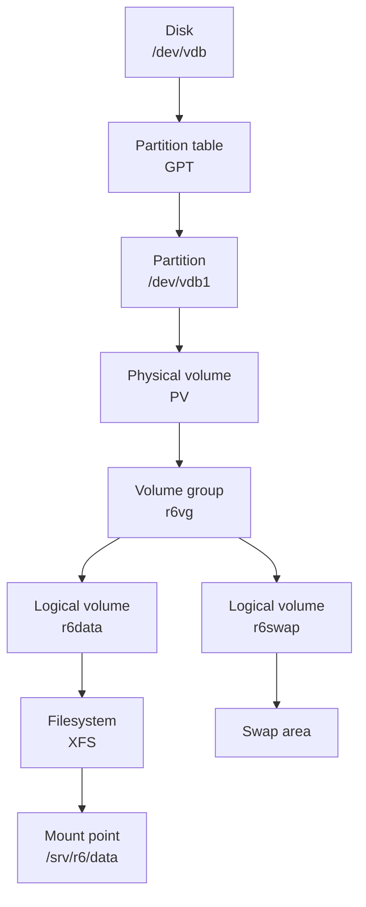

# R6 — Local storage

<div class="module-meta" markdown>

| | |
|---|---|
| **Exam objective group** | 5 — Configure local storage |
| **Time** | 3–4 hours including labs |
| **Prerequisites** | [R1 — Essential tools](../r01-essential-tools/index.md) and [F4 — Filesystem operations](../../foundations/f4-filesystem-operations/index.md). [F8](../../foundations/f8-networking-storage-selinux/index.md) introduces disks, partitions, and mounts |
| **Labs** | 2 guided labs + 1 challenge |
| **Check command** | `./bin/lab check r06 lab1` (also `lab2` and `challenge`) |

</div>

Storage is the part of the exam where a mistake is visible immediately: the filesystem does not mount, or it mounts until the next reboot and then does not. Group 5 asks you to take a bare disk, divide it, put a volume manager on it, create filesystems, and make them come back by themselves.

The good news is that the layers are strict. Each one only understands the layer below it. Once you can name the layer a command belongs to, the commands stop looking arbitrary.

## Objective checklist

By the end of this module you should be able to:

- [ ] List the disks, partitions, and filesystems on a system
- [ ] Create and delete a GPT partition table and partitions
- [ ] Mark a partition as a Linux LVM member
- [ ] Create and remove physical volumes
- [ ] Create a volume group and add physical volumes to it
- [ ] Create, extend, and remove logical volumes
- [ ] Put XFS and ext4 filesystems on logical volumes
- [ ] Mount a filesystem at boot by UUID and by label
- [ ] Add swap on a logical volume and make it persistent
- [ ] Extend a logical volume and grow its filesystem without losing data
- [ ] Prove every one of those changes survives a reboot

!!! note "Read it; do not memorise it"
    This page is a reference you will return to, not a list to learn by heart. The labs are where the commands become yours. If a command looks arbitrary now, run it on the lab and read the block beneath it, which shows what it prints.

    Command blocks have a copy button. Blocks **without** one are output: they show what a command printed and are there to compare against, not to paste into a shell.

---

## The storage stack

Every storage task in this module moves down this stack. A filesystem lives on a logical volume, a logical volume lives in a volume group, the volume group lives on one or more physical volumes, and each physical volume is a partition on a disk.



| Layer | The question it answers | Tools |
|---|---|---|
| Disk | What hardware is attached? | `lsblk`, `lsblk -f`, `blkid` |
| Partition table | How is this disk divided? | `parted`, `fdisk`, `sfdisk` |
| Partition | Where does this piece start and end? | `parted print`, `lsblk` |
| Physical volume | Which storage does LVM own? | `pvcreate`, `pvs` |
| Volume group | Which pool do I allocate from? | `vgcreate`, `vgextend`, `vgs` |
| Logical volume | What block device does the filesystem see? | `lvcreate`, `lvextend`, `lvs` |
| Filesystem | How are files and directories stored? | `mkfs.xfs`, `mkfs.ext4`, `blkid` |
| Mount | Where does it appear in the tree, and when? | `/etc/fstab`, `mount`, `findmnt` |

You do **not** have to use LVM to pass every storage task. The exam objectives name physical volumes, volume groups, and logical volumes explicitly, so this module builds the whole stack. A plain partition with a filesystem is the same idea with the middle three layers removed.

---

## Disks and partitions

A **disk** is a block device: `/dev/vda`, `/dev/vdb`, `/dev/sda`. The kernel exposes it as a stream of fixed-size blocks. On the course lab, `server` has a 20 GB root disk (`vda`) and a second 10 GB disk (`vdb`) that starts empty. Every exercise in this module uses `vdb`, which is why restoring the clean snapshot gives you a blank disk again.

```bash
lsblk
```

```text { .no-copy }
NAME   MAJ:MIN RM  SIZE RO TYPE MOUNTPOINTS
vda    252:0    0   20G  0 disk
├─vda1 252:1    0    1M  0 part
├─vda2 252:2    0  200M  0 part /boot/efi
├─vda3 252:3    0    1G  0 part /boot
└─vda4 252:4    0 18.8G  0 part /
vdb    252:16   0   10G  0 disk
```

`lsblk -f` adds the filesystem type, label, UUID, and mount point for each layer. It is the fastest way to see whether a device is formatted, and `lsblk` without options is the fastest way to see the shape of the disks.

### GPT versus MBR

The **partition table** records where each partition begins and ends. There are two formats in common use:

| | MBR (msdos) | GPT |
|---|---|---|
| Maximum disk | 2 TiB | Effectively unlimited |
| Primary partitions | 4 | 128 by default |
| Partition names | Not really | Yes, up to 36 characters |
| Partition type | One-byte code | 128-bit type GUID |
| Boot firmware | BIOS | UEFI (and BIOS) |

RHEL 10 installs on GPT, and the exam expects GPT. `parted` writes either; always pass `mklabel gpt` when you create a fresh table.

!!! warning "Creating a label destroys the old table"
    `parted /dev/vdb mklabel gpt` writes a new, empty partition table. Any partition entries already on the disk are gone, along with the filesystems they pointed at. On the lab `vdb` this is exactly what you want; on a real machine it is a destructive command.

### Creating a partition

`parted` has an interactive mode and a script mode. Use script mode (`-s`) in documentation and scripts: it takes one command, does it, and exits without prompting.

```bash
parted -s /dev/vdb mklabel gpt
parted -s /dev/vdb mkpart r6data 1MiB 5121MiB
parted -s /dev/vdb set 1 lvm on
```

The pieces:

| Argument | Meaning |
|---|---|
| `mklabel gpt` | Write a new GPT partition table |
| `mkpart r6data` | Create a partition with the GPT name `r6data` |
| `1MiB` | Start one mebibyte into the disk, not at sector 0 |
| `5121MiB` | End at 5121 MiB, giving a 5120 MiB (5 GiB) partition |
| `set 1 lvm on` | Give partition 1 the Linux LVM type GUID |

The 1 MiB start is not decoration. It keeps the partition aligned with the disk's internal erase blocks, which avoids read-modify-write cycles on SSDs and is the convention every modern tool follows. Let `parted` default the start to `1MiB` or state it explicitly; do not start at sector 0.

`set 1 lvm on` is what makes the partition a **Linux LVM** member. The flag is a GPT type GUID (`E6D6D379-F507-44C2-A23C-238F2A3DF928`). LVM does not strictly require it — `pvcreate` will accept a plain partition — but the type is what tells every other tool what the partition is for. Set it.

After changing a partition table, tell the kernel and udev to re-read it:

```bash
udevadm settle
```

`partprobe /dev/vdb` does the same job more directly. On a busy disk the kernel may refuse until the partitions are unused, which is why you unmount before deleting one.

### Listing and deleting partitions

```bash
parted -s /dev/vdb print
lsblk -o NAME,SIZE,TYPE,FSTYPE,MOUNTPOINTS /dev/vdb
```

```text { .no-copy }
Model: Virtio Block Device (virtblk)
Disk /dev/vdb: 10.7GB
Sector size (logical/physical): 512B/512B
Partition Table: gpt
Disk Flags:

Number  Start   End     Size    File system  Name    Flags
 1      1049kB  5370MB  5369MB               r6data  lvm
```

`parted` reports decimal units (`10.7GB`, `5369MB`); `lsblk` reports binary units (`10G`, `5G`). They describe the same disk. Use `lsblk` for the shape and `parted print` when you need the partition table details.

To delete a partition — partition 2, in this example:

```bash
parted -s /dev/vdb rm 2
udevadm settle
```

Deleting a partition does not erase the bytes; it only removes the entry that says where they are. If a filesystem was on it, the data is still on the disk but unreachable through the old device name. Treat `rm` as destructive anyway, because the next `mkpart` will reuse that space.

---

## LVM: physical volumes, volume groups, logical volumes

**LVM** (Logical Volume Manager) inserts a layer between partitions and filesystems. Instead of formatting `/dev/vdb1`, you hand that partition to LVM, allocate pieces of the resulting pool, and format those pieces. The payoff is flexibility: you can add another disk to the pool, grow a logical volume while it is mounted, and take snapshots.

### The vocabulary

| Term | Meaning | Example |
|---|---|---|
| **PV** | Physical volume: a partition or whole disk that LVM owns | `/dev/vdb1` |
| **VG** | Volume group: a pool made of one or more PVs | `r6vg` |
| **LV** | Logical volume: a block device allocated from a VG | `r6vg/r6data` |
| **PE** | Physical extent: the allocation unit inside a VG | 4 MiB by default |
| **LE** | Logical extent: one LE maps to one PE | 4 MiB by default |

LVM carves each PV into **physical extents** and hands out extents from the VG. A logical volume is a list of extents, which is why it can span disks without the filesystem knowing.

### Creating the three layers

```bash
pvcreate /dev/vdb1
vgcreate r6vg /dev/vdb1
lvcreate -n r6data -L 2G r6vg
```

| Command | What it does |
|---|---|
| `pvcreate` | Writes LVM metadata at the start of the partition |
| `vgcreate r6vg /dev/vdb1` | Creates a pool named `r6vg` from that PV |
| `lvcreate -n r6data -L 2G r6vg` | Allocates 2 GiB from the pool as `r6data` |

`lvcreate -L` takes an absolute size (`2G`, `512M`) and rounds up to whole extents. `-l` takes extents or a percentage (`-l 50%FREE`, `-l 512`), which is useful when you do not want to do the arithmetic. For exam tasks, `-L` is usually clearer.

The result appears under two equivalent paths:

| Path | Kind |
|---|---|
| `/dev/r6vg/r6data` | Symlink created by LVM, easy to type |
| `/dev/mapper/r6vg-r6data` | The device-mapper node the kernel actually uses |

Both work in every command. `fstab` should use neither: it should use the filesystem's UUID, as the labs show.

### Inspecting

```bash
pvs
vgs
lvs
```

```text { .no-copy }
  PV         VG   Fmt  Attr PSize  PFree
  /dev/vdb1  r6vg lvm2 a--  <5.00g <3.00g

  VG   #PV #LV #SN Attr   VSize  VFree
  r6vg   1   1   0 wz--n- <5.00g <3.00g

  LV     VG   Attr       LSize Pool Origin Data%  Meta%  Move Log Cpy%Sync Convert
  r6data r6vg -wi-a----- 2.00g
```

`PFree` and `VFree` are the space left. The `Attr` column tells you the state: `-wi-a-----` means writable, active, and allocated. `pvdisplay`, `vgdisplay`, and `lvdisplay` print the same information one object at a time, with the UUIDs that LVM uses internally.

### Extending

```bash
vgextend r6vg /dev/vdb2
lvextend -L +2G /dev/r6vg/r6data
```

`vgextend` adds a prepared PV to an existing VG, increasing its free space. `lvextend -L +2G` adds two gigabytes to the logical volume; without the `+` it would set an absolute size. After the LV is bigger, the filesystem on it is still the old size until you grow it, which is the subject of [the challenge](labs/challenge-extend-storage.md).

### Removing, in the right order

```bash
umount /srv/r6/data
lvremove /dev/r6vg/r6data
vgremove r6vg
pvremove /dev/vdb1
```

The order is the reverse of creation, and it is not optional:

1. **Unmount** the filesystem. `lvremove` refuses to remove a mounted LV, which protects you from deleting live data.
2. **Remove the fstab entry** and run `systemctl daemon-reload`, or the next boot will wait for a device that no longer exists.
3. **`lvremove`** the logical volume.
4. **`vgremove`** the volume group, which must have no LVs left.
5. **`pvremove`** the physical volume, which must not belong to a VG.
6. **`parted rm`** the partition, if you no longer need it.

`lvremove` and `vgremove` ask for confirmation interactively. In a script, add `-y`, but only after you have read the device name twice.

---

## Filesystems

A **filesystem** is the structure that turns a block device into files and directories. RHEL's default is **XFS**; **ext4** is the other filesystem you are expected to know. Both are journaling filesystems, both support labels and UUIDs, and both can be grown online.

```bash
mkfs.xfs /dev/r6vg/r6data
mkfs.ext4 -L r6label /dev/r6vg/r6label
```

| Command | Creates | Can shrink? | Grow command |
|---|---|---|---|
| `mkfs.xfs` | XFS | No | `xfs_growfs <mount point>` |
| `mkfs.ext4` | ext4 | Yes, offline | `resize2fs <device>` |

`mkfs.ext4 -L r6label` writes a **label** into the superblock. `mkfs.xfs -L` does the same. A label is a human-readable name; a UUID is a machine-generated identifier. `fstab` can use either, and the labs use one of each so you see both.

!!! danger "`mkfs` destroys what is already there"
    `mkfs.xfs /dev/vdb1` does not ask whether `/dev/vdb1` holds data. It writes a new filesystem over the start of the device. On a whole disk with partitions, `mkfs.xfs /dev/vdb` destroys the partition table too. Check with `lsblk -f` and `blkid` before you format, and format logical volumes or partitions, never a disk that has a table you care about.

### Reading the result

```bash
blkid /dev/r6vg/r6data
blkid /dev/r6vg/r6label
lsblk -f
```

```text { .no-copy }
/dev/r6vg/r6data: UUID="c85a2f7f-0620-4d82-878f-d40fa93eb239" BLOCK_SIZE="512" TYPE="xfs"
/dev/r6vg/r6label: LABEL="r6label" UUID="4a885302-5086-44b3-aedb-74e8150c8f09" BLOCK_SIZE="4096" TYPE="ext4"
```

`blkid` reads the superblock and prints what it finds. That output is where the UUID and label in `fstab` come from — copy them from the machine, do not invent them.

!!! note "Yours will differ"
    UUIDs are generated per filesystem. Every UUID in this module's output is from one walk of the lab; on your machine the values will be different. The shape of the output is what matters.

---

## Mounting at boot: `/etc/fstab`

A **mount** attaches a filesystem to a directory. The kernel does it on demand, but nothing makes it happen at boot unless it is recorded in `/etc/fstab`.

Each line has six fields:

```text { .no-copy }
UUID=c85a2f7f-0620-4d82-878f-d40fa93eb239  /srv/r6/data  xfs  defaults  0 0
```

| Field | Meaning |
|---|---|
| 1 | Source: `UUID=`, `LABEL=`, or a device path |
| 2 | Mount point: an existing directory |
| 3 | Filesystem type: `xfs`, `ext4`, `swap`, `vfat` |
| 4 | Options: `defaults` is `rw,suid,dev,exec,auto,nouser,async` |
| 5 | Dump: `0` means "do not dump"; almost always `0` |
| 6 | `fsck` order: `0` for no check, `1` for root, `2` for other filesystems |

### UUID and LABEL instead of `/dev/vdb1`

Device names are not stable. Add a disk and `/dev/vdb` may become `/dev/vdc`; the root filesystem may move from `sda` to `nvme0n1`. A UUID is written into the filesystem and travels with it. A label does the same, but you choose it and it must be unique enough to be unambiguous.

| Source | Survives reordering | Survives a new filesystem | Human-readable |
|---|---|---|---|
| `/dev/vdb1` | No | Yes | Somewhat |
| `UUID=...` | Yes | No — new UUID | No |
| `LABEL=...` | Yes | No — label may change | Yes |

The exam wording is "by UUID or label", so both are fair. UUID is the safer default; a label is useful when you want the same fstab line to find a filesystem you rebuild with the same label.

### Applying an fstab change

Editing `/etc/fstab` does not mount anything. Three commands matter:

```bash
systemctl daemon-reload
mount -a
findmnt --verify
```

| Command | Why |
|---|---|
| `systemctl daemon-reload` | Regenerates the systemd `.mount` and `.swap` units from the new fstab |
| `mount -a` | Mounts everything in fstab that is not mounted yet |
| `findmnt --verify` | Parses fstab, checks that every source resolves, and reports warnings |

`mount -a` is the honest test: if a line is wrong, it fails now rather than at the next boot. `findmnt --verify` catches a stale source, a missing mount point, and unsupported options before they become an emergency-mode boot.

!!! warning "A bad fstab can stop the boot"
    If a non-essential filesystem cannot mount, systemd may drop to emergency mode and wait. For removable or optional storage, add `nofail` to the options (`defaults,nofail`). Do not put `nofail` on `/`, `/boot`, or anything the system needs to start.

`findmnt` reads the live mount table; `findmnt --fstab` reads the file:

```bash
findmnt /srv/r6/data
findmnt --fstab -o SOURCE,TARGET /srv/r6/data
```

```text { .no-copy }
TARGET       SOURCE                  FSTYPE OPTIONS
/srv/r6/data /dev/mapper/r6vg-r6data xfs    rw,relatime,seclabel,attr2,inode64,logbufs=8,logbsize=32k,noquota

SOURCE                                  TARGET
UUID=c85a2f7f-0620-4d82-878f-d40fa93eb239 /srv/r6/data
```

The first says "this is mounted now". The second says "this is what fstab will do at boot". You need both.

---

## Swap

**Swap** is disk space the kernel uses when memory is short. It is not a filesystem: there are no files or directories on it, only pages moved out of RAM. A swap area can be a partition, a logical volume, or a file.

```bash
lvcreate -n r6swap -L 512M r6vg
mkswap /dev/r6vg/r6swap
swapon /dev/r6vg/r6swap
swapon --show
free -h
```

```text { .no-copy }
NAME      TYPE      SIZE USED PRIO
/dev/dm-1 partition 512M   0B   -2

               total        used        free      shared  buff/cache   available
Mem:           3.8Gi       591Mi       2.8Gi        12Mi       659Mi       3.2Gi
Swap:          511Mi          0B       511Mi
```

`mkswap` writes the swap signature and a UUID. `swapon` activates it for this boot. `swapon --show` lists active swap areas; `free -h` shows the total the kernel sees.

### Making swap persistent

Add it to fstab with `none` as the mount point and `swap` as the type:

```text { .no-copy }
UUID=40027ec7-bc8e-4267-a85b-05e02d72679b none swap defaults 0 0
```

Then apply it the same way as a mount:

```bash
systemctl daemon-reload
swapon -a
```

`swapon -a` reads fstab and activates every swap entry that is not already on. `swapoff -a` turns them all off. Unlike `mount -a`, `swapon -a` is not run automatically by `mount -a`; the swap line has its own path through systemd.

The `PRIO` column is the priority. If you have several swap areas, the kernel uses the higher priority first. `-2` is the default for an fstab entry without a `pri=` option.

---

## Growing storage without losing data

The exam phrase is "add new partitions and logical volumes, and swap to a system non-destructively". In practice it means this sequence, in this order:

| Step | Command | What grows |
|---|---|---|
| 1 | `parted -s /dev/vdb mkpart ...` | The partition |
| 2 | `pvcreate /dev/vdb2` | The LVM physical volume |
| 3 | `vgextend r6vg /dev/vdb2` | The volume group's free space |
| 4 | `lvextend -L +2G /dev/r6vg/r6data` | The logical volume |
| 5 | `xfs_growfs /srv/r6/data` | The filesystem |

Skipping step 5 is the classic mistake. `lvs` shows the new size, but `df -h` still shows the old one, because the filesystem has not been told that the device got bigger. Growing the filesystem before the LV fails for the opposite reason: there is no new space to claim.

XFS can only grow. It cannot shrink, online or offline. ext4 can shrink offline with `resize2fs`, but that is not an exam objective for this group and carries real risk; do not shrink a filesystem to solve a space problem you can solve by adding a disk.

!!! tip "`lvextend -r` does both steps"
    On RHEL, `lvextend -r -L +2G /dev/r6vg/r6data` calls the right filesystem grow tool for you. It is convenient and correct. The labs do the two steps separately on purpose, because the exam may ask you to explain which layer changed and `df` is the proof that the filesystem followed the volume.

---

## Common traps

| Trap | What happens | Fix |
|---|---|---|
| Formatting `/dev/vdb` instead of `/dev/vdb1` | The partition table is destroyed | Format the partition or LV; check with `lsblk -f` first |
| Using `/dev/vdb1` in fstab | The filesystem may not mount after disks are reordered | Use `UUID=` or `LABEL=` |
| Editing fstab without `daemon-reload` | systemd keeps the old mount unit; `findmnt --verify` warns | Run `systemctl daemon-reload`, then `mount -a` |
| Forgetting `mount -a` | The entry works at boot but not now | `mount -a` |
| Extending the LV but not the filesystem | `lvs` is bigger, `df` is not | `xfs_growfs` or `resize2fs` |
| Growing the filesystem before the LV | `xfs_growfs` reports no change, or fails | Extend the LV first |
| Writing swap to fstab but not running `swapon -a` | Swap is off until the next boot | `swapon -a`, then `swapon --show` |
| Deleting a partition before its LV | LVM cannot find the PV; the VG is damaged | `umount`, `lvremove`, `vgremove`, `pvremove`, then `parted rm` |
| `parted` waiting for input | A script hangs at a prompt | Use `parted -s` |
| Wrong UUID copied into fstab | Boot waits, then drops to emergency mode | `blkid`, copy the value, `findmnt --verify` |
| `mkfs` on a mounted filesystem | Refused, or the filesystem is corrupted | `umount` first; LVM/NFS make this easy to hit |

---

## Next

[Lab 1 — A partition, a volume group, and a UUID mount](labs/lab-1-partitions-and-lvm.md) builds the stack from a blank `/dev/vdb`: GPT, a 5 GiB partition, a PV, a VG, a 2 GiB XFS logical volume, and an fstab entry by UUID. [Lab 2 — Swap and a label](labs/lab-2-swap-and-labels.md) adds swap and an ext4 volume mounted by `LABEL=`. The [challenge](labs/challenge-extend-storage.md) adds a second partition, extends the volume group, and grows the filesystem while it is mounted.
